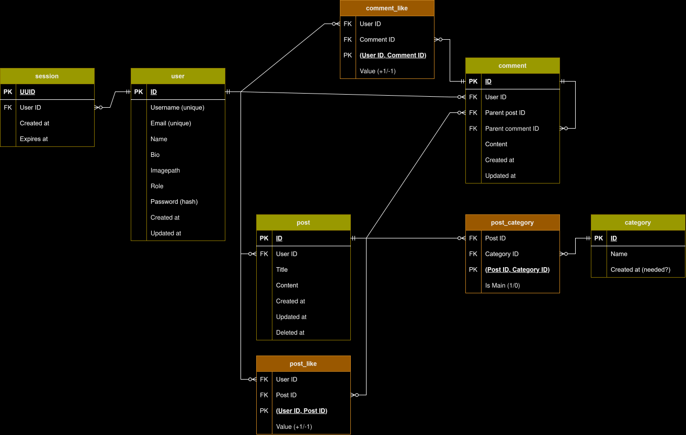

# Literary Lions forum<br>

## Overview<br>

A server-rendered web forum for discussing literature, implemented in Go with databases done in SQLite.  
Registered users can post, comment, reply and react, as well as search the forum.  
Guests can browse and read the posts and comments.

## Project structure tree:<br>
```text
forum/
├── main.go               # Entrypoint: parse flags (-i seed, -d delete), start server
├── Dockerfile            # Multi-stage build (cgo + FTS5), runs ./forum -i
├── compose.yaml          # Docker Compose: build, port 8080, data/uploads volumes
├── Makefile              # run / reset / build / test shortcuts
├── go.mod / go.sum
│
├── server/               # HTTP server wiring (dependencies, routes, middleware chains)
├── middleware/           # Recoverer, AllowGuest, Restrict, Admin
│
├── handlers/             # HTTP handlers (one per domain) + view structs
│                         #   post/comment/user/reaction/category/admin/auth/search
│                         #   pagination.go (generic paginate helper), pagestructs.go
├── service/              # Business logic (auth, hashing, roles, reactions)
├── repository/           # Data access (SQL) — one file per table group
│                         #   incl. search_repository.go (FTS5 posts/comments, LIKE users)
├── models/               # Domain types, view models, validation
│
├── database/             # db.go (open SQLite), schema.sql (tables+FTS, go:embed), seed.go
├── utils/                # templates, argon2id hashing, UUIDv7 session ids
├── errors/               # Typed app errors + SQL error mapping
│
├── templates/            # html/template views
│   └── partials/         #   nav, comment_card, pagination, reaction, tables, …
└── static/               # Served assets
    ├── css/              #   stylesheets
    └── assets/images/    #   default avatars + uploaded profile pictures
```

## Setup and Usage <br>
### Setup
`git clone https://github.com/alia-dd/forum`

`cd forum`

Then either

`make run` or `go run -tags fts5 . -i` to run the program.

or

`docker compose up --build` to build and start the docker image. 

In either case the site is accessible at `http://localhost:8080/`  

### Usage
There is a pre-made admin account, use the following to login with it:  
Username: alice  
Password: 1234abcd?Really  
Confirmation password for admin actions: 12345  

Admin panel allows you to adjust user roles, delete posts and create/edit categories. Comment deletion is handled via going into the post in question and deleting from there.  

Otherwise the usage of the site is what one would expect of a web forum; you can post and comment, edit your profile or postings, like and dislike things, reply to other users, delete your account and search for users, posts or comments.  

## Additional features<br>
### Proposed bonuses:<br>
All listed ones should be implemented, some notable ones listed here:  

Passwords are hashed using Argon2id (golang.org/x/crypto), one of the most recommended password-hashing algorithms for its security.  

Search functionality implemented with selectable scope and sort, FTS5 for better performance and relevance ranking, support for exact-phrase matching (wrap whatever you're searching in quotes to use this) and wildcard matching.  

Profile pages that showcase a user-written bio as well as list their posts/comments to other people. The profile-owner can change their settings there, such as password, profile picture and bio, as well as view their own liked posts.  

### Extra bonuses:<br>
Admin panel and functionality for user moderation + user roles.  

User-uploaded avatars for profiles.  

Pagination.  

Replying to comments in addition to commenting on the post.  

Editing content you have posted, deleting your account.  

Soft-deletion that preserves nested comments when their parent gets deleted.  

## Entity-Relationship Diagram:<br>
